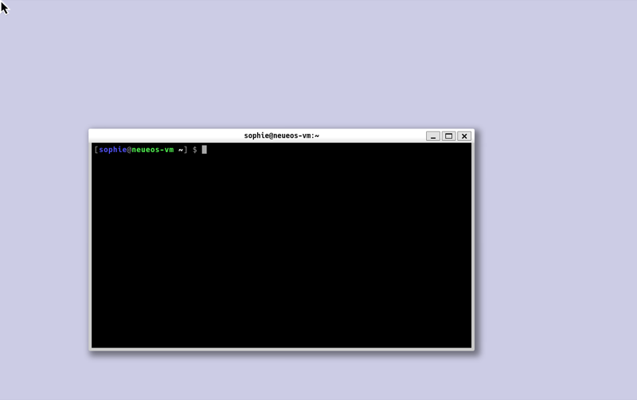
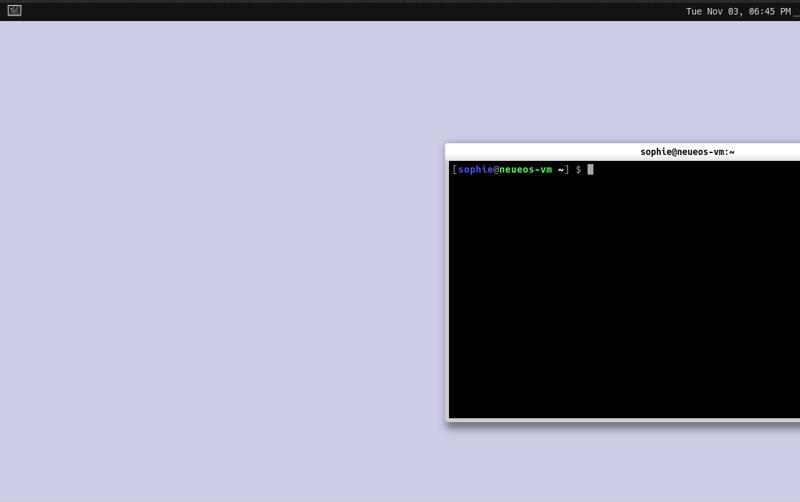
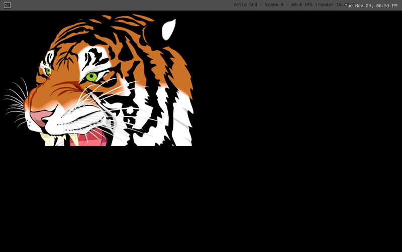

# VM graphics checks (task 0.5, 2026-11-03)

Run in the Parallels VM `neueos-vm` (see `docs/dev-setup.md` §2), driven over SSH from the Mac.
Screens were checked with `prlctl capture neueos-vm --file <png>` on the Mac.

**Result: accepted.** Smithay's `anvil` shows a client window on the VM's DRM device, and also
nested under a stock compositor (weston). All three vello renderers draw in the VM.
One blocker was found and fixed: archboot's `kmscon` console holds DRM master (see below).

## Environment
| Item | Value |
|---|---|
| Host | Apple M4 Max, macOS 27.2, Parallels 27.1.0 |
| Guest | Arch Linux ARM, kernel `linux-aarch64` 7.3.1-2, 4 vCPU, 16 GB |
| Mesa / seatd / weston | 26.2.6 / 0.9.3 / 15.0.1 |
| Smithay | `c7a26ad` (main, 2026-11-02), anvil built with `--no-default-features --features egl,winit,udev` (no X11/Xwayland) |
| vello | `a73e096` (main, 2026-11-03) |
| Toolchain | Rust 1.98.1 (the repo's pinned toolchain) |

## Facts
### GPU and EGL
- Kernel: `virtio-vga` with `[drm] features: +virgl -edid -resource_blob -host_visible -context_init`.
  No blob resources and no context init, so **no Venus** (no virtualized Vulkan) is possible.
- `eglinfo -B`: GBM, Wayland, surfaceless and device platforms all report
  **`virgl (Apple M4 Max (Compat))`**, OpenGL 4.0 core and **OpenGL ES 3.0**. This is hardware GL via
  virgl, not llvmpipe.
- `vulkaninfo --summary`: one device, **llvmpipe** (CPU, Vulkan 1.4). There's no hardware Vulkan.
- GLES 3.0 means no compute shaders (they need GLES 3.1). Compute-based GPU rendering in the VM
  runs on llvmpipe.

### DRM/KMS (`modetest -M virtio_gpu`)
- 16 connectors (`Virtual-1`…`16`), only `Virtual-1` connected. Its preferred mode is **1224x768**
  (the Parallels window size), with 34 more modes up to 4096x2160. No EDID.
- **Atomic modesetting: yes** (weston and Smithay both use it). No atomic async page flip.
- Per CRTC: one primary plane (`XR24` only) and one **cursor plane** (`AR24`). No overlay planes,
  no `IN_FORMATS` (no modifiers, linear only). No 10-bit formats: anvil warns that AB30/AR30/AB24 are
  unavailable and falls back to XR24. This is harmless.
- The DRM fd works through **seatd from an SSH session** (user in `seat` and `video`). No logind
  seat session or console login is needed.

### Blocker: kmscon holds DRM master (fixed)
archboot installs `kmscon` as the tty1 console (`kmsconvt@tty1.service`, and `autovt@.service` is a
link to it). kmscon keeps DRM master, so seatd logs `Could not make device fd drm master: Device
or resource busy` and every atomic commit fails with `EACCES` ("Permission denied" in weston).
**Fix:** use the stock `getty@tty1` (fbcon) instead; see `docs/dev-setup.md` §2.3. After that,
`/sys/kernel/debug/dri/0/clients` shows the compositor's fd (opened by seatd) as master.

### anvil on DRM
`anvil --tty-udev` started over SSH (`XDG_RUNTIME_DIR=/run/user/1000`), then `weston-terminal` on
anvil's socket. It used `renderD128` as the primary GPU, EGL on GBM, and the GLES renderer on virgl
GLES 3.0, with an atomic surface on CRTC 40 / plane 35 at 1224x768. The window rendered correctly
(screenshot below). Warnings seen:
- `Unable to become drm master, assuming unprivileged mode`. This is harmless, because seatd had
  already made the fd master.
- `Failed to destroy old mode property blob` (once, at startup).
- A missing xcursor theme, so anvil used its fallback cursor.



### anvil nested under a stock compositor
weston (`--backend=drm`, desktop shell) on DRM, with `anvil --winit` as a client and
`weston-terminal` inside anvil. EGL used the Wayland platform, virgl GLES 3.0 and a 10-bit
(`color_bits: 30`) EGL config. It rendered correctly. There was one
`EGL BAD_SURFACE eglQuerySurface` at startup, with no visible effect.
weston itself on DRM with `weston-terminal` and `weston-simple-egl` also works.



### vello demos (under weston, default tiger scene, window about 1224x736)
| Renderer | Backend | Result |
|---|---|---|
| `vello_gpu` (`vello_gpu/examples/winit`) | wgpu **GL** → virgl GLES 3.0 | renders, **60 FPS**, vsync-bound (Fifo; render about 16.6 ms includes the wait) |
| `vello_gpu` | wgpu Vulkan → llvmpipe | renders, about 155 FPS uncapped (Immediate, render 6.4 ms); 57 FPS with Fifo |
| `vello` compute (`research/examples/with_winit`) | wgpu Vulkan → llvmpipe | renders, about 650 FPS |
| `vello_cpu` (`vello_cpu/examples/winit`) | CPU, softbuffer | renders, about 640 FPS (1.56 ms/frame) |



To run `vello_gpu` on GL, three local changes to the example were needed. They are example
problems, not VM problems:
1. Create the wgpu `Instance` with the winit display handle
   (`display: Some(Box::new(event_loop.owned_display_handle()))`). With `display: None`, wgpu-hal's
   EGL backend falls back to surfaceless and no adapter is compatible with the window ("No
   compatible device").
2. Request `adapter.limits()` instead of `Limits::default()`. Default WebGPU limits exceed GLES 3.0.
3. Use `PresentMode::Fifo`. The GL surface offers only `[Fifo]`, and the example requests `Immediate`.

The compute `vello` renderer can't use the GL backend (no compute on GLES 3.0). Its wgpu path in
the VM is therefore llvmpipe (inferred; llvmpipe is the only Vulkan adapter).

## Interpretation
- **The VM is usable for compositor development.** The DRM backend with atomic KMS, cursor plane,
  GBM, EGL and the GLES renderer all work under seatd, and nested development works under any stock
  Wayland session.
- **Our toolkit's GPU path in the VM:** `vello_gpu` on wgpu GL (virgl) is real hardware rendering.
  `vello` compute only gets llvmpipe. This supports `vello_gpu` over `vello` for ADR 0002, alongside
  R4. Our wgpu setup must pass the display handle to the instance and must not assume `Immediate`
  present mode or default limits.
- **FPS in the VM is not a performance signal.** llvmpipe numbers measure CPU raster on M4 cores.
  Performance work still needs real x86_64 hardware (AGENTS.md).

## Tooling notes
- `prlctl capture` is reliable for static screens but can return a partial frame while a client
  redraws every frame: the bottom of the image is black, or the whole image is black. Of two
  captures 4 s apart during the GL demo, one was complete and one was all black. Capture several
  times, or look at the VM window.
- weston blanks the output after 300 s idle (`--idle-time`), and Fifo clients then stall. Use
  `weston --idle-time=0` for unattended runs.
- `drm_info` is not packaged for Arch Linux ARM; `modetest` (in `libdrm`) works.
- `pkill -f <pattern>` inside `ssh host '…'` matches the remote shell's own command line and kills
  it. Use `pkill -x <name>`.

## Open questions (owner, at the VM window)
1. **GL flicker:** while `vello_gpu` runs on GL, does the window show the tiger steadily, or does it
   flicker black? The capture tooling can't tell the difference (see above). Run:
   ```sh
   ssh neueos-vm 'cd ~/src/vello && XDG_RUNTIME_DIR=/run/user/1000 WAYLAND_DISPLAY=wl-stock \
     WGPU_BACKEND=gl timeout 30 target/release/vello_gpu_winit'
   ```
   (This needs weston running on `wl-stock`; see the anvil commands below for how to start it.)
2. **Resize to hotplug:** resize the Parallels window while anvil runs on DRM. Does a new preferred
   mode and a hotplug uevent arrive, and does anvil follow it?
3. **Input:** do the keyboard and pointer work in anvil on DRM (libinput via seatd)? For example,
   Logo+Return should open `weston-terminal`, and Logo+Q should quit.
4. **Vblank timing:** frame pacing measured with `weston-presentation-shm` under weston. Not run.

## Reproduce
On the VM (packages: `weston wayland-utils`; build deps are already in dev-setup §2.3):
```sh
git clone --depth 1 https://github.com/Smithay/smithay ~/src/smithay
cd ~/src/smithay && cargo +1.98.1 build --release -p anvil --no-default-features --features egl,winit,udev
export XDG_RUNTIME_DIR=/run/user/1000
# DRM:
~/src/smithay/target/release/anvil --tty-udev &   # then: WAYLAND_DISPLAY=wayland-1 weston-terminal
# Nested:
weston --backend=drm --idle-time=0 --socket=wl-stock &
WAYLAND_DISPLAY=wl-stock ~/src/smithay/target/release/anvil --winit &
```
vello: clone `https://github.com/linebender/vello`, apply the three example changes above, then
`cargo build --release -p vello_gpu_winit -p with_winit -p vello_cpu_winit`, and run the binaries
under weston with `WGPU_BACKEND=gl` or `WGPU_BACKEND=vulkan`.
